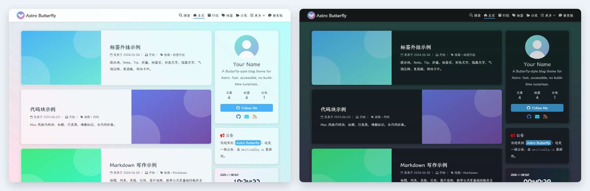
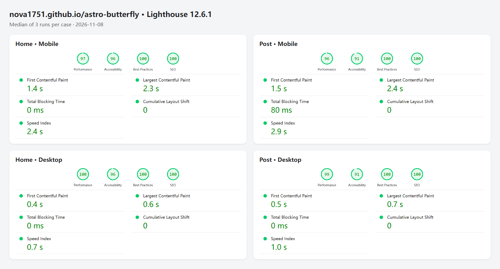

<div align="center">

# Astro Butterfly

一个外观与 [hexo-theme-butterfly](https://github.com/jerryc127/hexo-theme-butterfly) 一致的 [Astro](https://astro.build) 博客主题。生成纯静态 HTML，每个页面只加载用得到的脚本，并附带从 Hexo Butterfly 博客迁移过来的工具。

**[在线演示](https://nova1751.github.io/astro-butterfly/)** · [English](./README.md) · [配置](./docs/configuration.md) · [写作语法](./docs/writing.md) · [从 Hexo 迁移](./docs/migrate-from-hexo.md)




</div>

## 特性

**Butterfly 的外观，重新实现**
- 首页文章卡片、作者卡片、公告、分类、标签云、归档、网站资讯、吸顶目录，以及右下角的悬浮按钮组。
- 浅色、深色两种模式：默认跟随系统，手动切换后记住两天，和 Butterfly 一样。另有阅读模式和单栏切换。
- Mac 风格代码块：由 [Expressive Code](https://expressive-code.com/) 在构建时渲染，支持标题、行高亮、增删行标记、复制、折叠，长代码会自动收起并显示展开条。
- Butterfly 与 tag-plugins-plus 的标签外挂改用标准 Markdown 语法书写：Note、Tip、折叠块、标签页、彩色文字、复选框、隐藏文字、气泡注释、网站卡片。

**开箱即用，不用注册任何服务**
- 站内全文搜索：使用 [Pagefind](https://pagefind.app/)，构建时生成索引，不依赖外部服务。
- Atom 订阅、`sitemap.xml` / `sitemap.txt`、`robots.txt`、Web App Manifest、Open Graph 标签和 canonical 链接。
- KaTeX 数学公式、图片灯箱、用 alt 文字生成的图片说明、字数与阅读时长统计、旧文章过期提醒。
- 文章的"更新于"自动跟随 git 提交，不用手动维护；批量格式化之类的提交可以用 `.git-blame-ignore-revs` 排除。
- 简繁切换；只在加载慢时才出现的顶部进度条；Butterfly 的打字冒光特效。

**可选服务**，填入对应的 key 即可开启
- [Twikoo](https://twikoo.js.org/) 评论，以及侧栏的"最新评论"卡片。
- 侧栏电子钟，按访客所在地显示天气（[和风天气](https://dev.qweather.com/)，支持全球）。
- [APlayer](https://aplayer.js.org/) 悬浮音乐播放器，歌单来自 Meting API。
- [不蒜子](https://busuanzi.ibruce.info/) 访问统计。

**浏览器端又轻又稳**
- 首次加载只运行约 19 KB（gzip 后）的 JS，包括无刷新跳转、链接预取和主题交互。
- 其余功能用到时才加载：Twikoo 在评论区快进入视野时加载，PhotoSwipe 在第一次点击图片时加载，Pagefind 在打开搜索时加载，APlayer 只在配置了歌单后加载，Mermaid 在图表快进入视野时加载，简繁对照表在第一次切换到繁体时加载。
- 不开 JS 也能正常阅读；第三方服务很慢或出错时，页面照常可用。
- 支持键盘和读屏：标签页可以用方向键切换，焦点清晰可见，并遵循系统的"减少动态效果"设置。

## 性能



| 页面 | 性能 | 无障碍 | 最佳做法 | SEO | FCP | LCP | TBT | CLS |
| --- | --- | --- | --- | --- | --- | --- | --- | --- |
| 首页 · 手机 | 97（95–98） | 96 | 100 | 100 | 1.4 s | 2.3 s | 0 ms | 0 |
| 文章页 · 手机 | 96（94–96） | 91 | 100 | 100 | 1.5 s | 2.4 s | 80 ms | 0 |
| 首页 · 桌面 | 100（100–100） | 96 | 100 | 100 | 0.4 s | 0.6 s | 0 ms | 0 |
| 文章页 · 桌面 | 99（99–99） | 91 | 100 | 100 | 0.5 s | 0.7 s | 0 ms | 0 |

2026-11-08 测于 [demo 站点](https://nova1751.github.io/astro-butterfly/)，文章页为 [Markdown 写作](https://nova1751.github.io/astro-butterfly/posts/2b3c4d5e/)。工具是本机的 Lighthouse 12.6.1 CLI，使用默认的模拟节流，每组跑 3 次。表中和图中是性能分的中位数那一次，括号里是 3 次的范围。分数随设备和网络波动，你自己的内容、字体和第三方脚本也会影响结果。

## 快速开始

需要 Node.js 22.12 或更高版本，以及 [pnpm](https://pnpm.io/)。

```bash
pnpm create astro@latest my-blog --template nova1751/astro-butterfly
cd my-blog
pnpm dev            # http://localhost:4321
```

也可以在 GitHub 上点 **Use this template**，直接得到一个能部署到 GitHub Pages 的副本。

接下来：

1. 修改 `src/config.ts`：站点地址、标题、作者、头像、菜单、社交链接。每一项都有注释，详见 [docs/configuration.md](./docs/configuration.md)。
2. 把 `src/content/posts/` 里的示例文章换成你自己的。`pnpm new "标题" 分类` 会生成一篇写好 Front Matter 的新文章。
3. 替换 `public/img/` 里的图片。

| 命令 | 作用 |
| --- | --- |
| `pnpm dev` | 启动本地开发服务器，修改后自动刷新。开发模式下没有搜索，因为索引由 `pnpm build` 生成 |
| `pnpm build` | 构建到 `dist/`，并生成搜索索引 |
| `pnpm preview` | 在本地预览 `dist/` |
| `pnpm new "标题" [目录]` | 新建文章，自动生成不重复的 `abbrlink` |
| `pnpm check` | TypeScript 与 Astro 检查 |
| `pnpm test` / `pnpm test:e2e` | 单元测试 / 浏览器测试（Playwright，针对构建产物运行） |
| `pnpm migrate:tags [路径]` | 转换 Hexo 的 `` 写法，见 [迁移指南](./docs/migrate-from-hexo.md) |

## 目录结构

```text
├── public/                 原样复制的静态文件（图片、字体）
├── scripts/                新建文章、Hexo 标签迁移、LED 字体构建
├── src/
│   ├── config.ts           ← 站点配置
│   ├── content/
│   │   ├── posts/          ← 文章（目录结构随意）
│   │   └── pages/          ← 独立页面：about/、link/、comments/ …
│   ├── content.config.ts   Front Matter 校验（兼容 Hexo）
│   ├── pages/              路由：首页、文章、归档、标签、分类、订阅、sitemap
│   ├── plugins/            remark/rehype 插件：提示块、指令、标题锚点、图片说明
│   ├── lib/                文章查询、日期、字数统计、与 Hexo 一致的锚点生成
│   └── theme/              布局、组件、浏览器脚本、样式
└── tests/                  单元测试（Vitest）与浏览器测试（Playwright）
```

日常使用基本只需要改 `src/config.ts` 和 `src/content/`。想改样式的话，先看 `src/theme/styles/global.css` 开头的颜色变量。

## 写作

文章是 Markdown 文件，Front Matter 沿用 Hexo 的写法：

```yaml
---
title: 你好
date: 2024-06-01 10:00:00
abbrlink: 1a2b3c4d        # 文章地址为 /posts/1a2b3c4d/
tags: [Astro]
categories: [笔记]
cover: /img/covers/1.svg
---
```

除了标准的 GitHub 风格 Markdown，还支持 GitHub 提示块（`> [!TIP]`）、数学公式（`$…$`、`$$…$$`）、Mermaid 图表（` ```mermaid ` 代码块），以及用来书写 Butterfly 标签外挂的指令语法：

```md
:::note{.blue .flat icon="fas fa-bullhorn"}
带自定义图标的 Note
:::

:::details[点击展开]{.green}
折叠内容
:::

:span[红色文字]{.red}  :spoiler[隐藏文字]  :tooltip[词语]{tip="解释"}
```

完整语法及渲染效果见 [docs/writing.md](./docs/writing.md) 和示例文章。

## 部署

构建产物是一个静态的 `dist/` 目录，任何静态托管都可以用。

| 平台 | 设置 |
| --- | --- |
| Vercel / Netlify / Cloudflare Pages | 导入仓库；构建命令 `pnpm build`，输出目录 `dist` |
| GitHub Pages | 已经配置好了：在仓库 Settings → Pages 里把 Source 设为 **GitHub Actions**。之后每次推送到 `main` 都会运行 `.github/workflows/pages.yml`，它会自动识别站点地址和子路径（`https://<你>.github.io/<仓库>/`） |
| 自己的服务器 | 运行 `pnpm build` 后托管 `dist/`；访问不存在的路径时返回 `404.html` |

部署前先把 `src/config.ts` 里的 `site.url` 改成你的真实域名，订阅、sitemap 和 canonical 链接都会用到它。如果要在其他平台上部署到子路径，设置 `site.base`（比如 `'/blog'`）。主题里的所有链接、搜索索引、订阅，以及 Markdown 里以 `/` 开头的链接和图片，都会自动加上这个前缀。

## 从 Hexo Butterfly 迁移

Hexo 博客的大部分内容可以原样搬过来：Front Matter 与日期格式、`/posts/:abbrlink/` 文章地址、标题锚点（按 Hexo 的规则生成，旧的 `#锚点` 链接依然有效），以及 `/atom.xml` 订阅地址。标签外挂用一条命令就能转换：

```bash
pnpm migrate:tags src/content/posts      # 、、 … → Markdown
pnpm migrate:tags --check src/content    # 列出没转换干净的地方
```

完整步骤见 [docs/migrate-from-hexo.md](./docs/migrate-from-hexo.md)，其中也包括清理旧的 Service Worker 和保留订阅用户的做法。

## 致谢

本主题改编自以下项目的设计与素材：Jerry Chen 的 [hexo-theme-butterfly](https://github.com/jerryc127/hexo-theme-butterfly)，以及 Akilar 的 [hexo-butterfly-tag-plugins-plus](https://github.com/Akilarlxh/hexo-butterfly-tag-plugins-plus) 和 [hexo-butterfly-envelope](https://github.com/Akilarlxh/hexo-butterfly-envelop)。这三个项目都采用 Apache-2.0 协议。本主题与它们没有隶属关系。完整清单见 [NOTICE](./NOTICE)，其中还有关于 LED 时钟字体的说明。

## 许可证

[Apache-2.0](./LICENSE)
